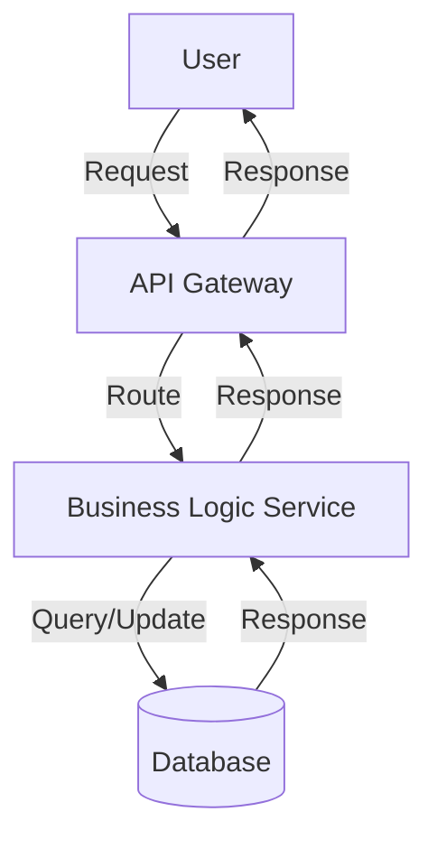

> **Review status:** Draft

## Context

<!-- Current state and constraints that shape the approach. See proposal.md for motivation - don't restate it -->

## Goals / Non-Goals

**Goals:**
<!-- What this design aims to achieve -->

**Non-Goals:**
<!-- What is explicitly out of scope -->

## Solution Overview

<!-- High-level description of the solution. No code, class names, method names or implementation steps. -->

## Architecture

<!-- Components, responsibilities, interactions. Include Mermaid diagrams. Example:

Use mermaid for:
- Component diagrams (graph TB/LR)
- Sequence diagrams (sequenceDiagram)
- Flowcharts (graph TD)
- State diagrams (stateDiagram)

See: https://mermaid.js.org
-->

## Traceability

<!-- | Spec requirement / scenario | Design element |  -->

## Data Model Impact

<!-- Entities and schema changes -->

## API Contract Changes

<!-- New or changed contracts (shape and behaviour only) -->

## Non-Functional Requirements

<!-- Security, performance, reliability, etc. -->

## Decisions

<!-- Key design decisions with rationale and alternatives considered -->

## Trade-offs & New Patterns

<!-- Trade-offs, new design patterns introduced, and organisational patterns referenced -->

## Risks

<!-- [Risk] → Mitigation -->

## Migration Plan

<!-- Deploy and rollback steps, if applicable -->

## Open Questions & Unknowns

<!-- | # | Question / Unknown | Status (open/resolved) | User's answer | Date | -->
